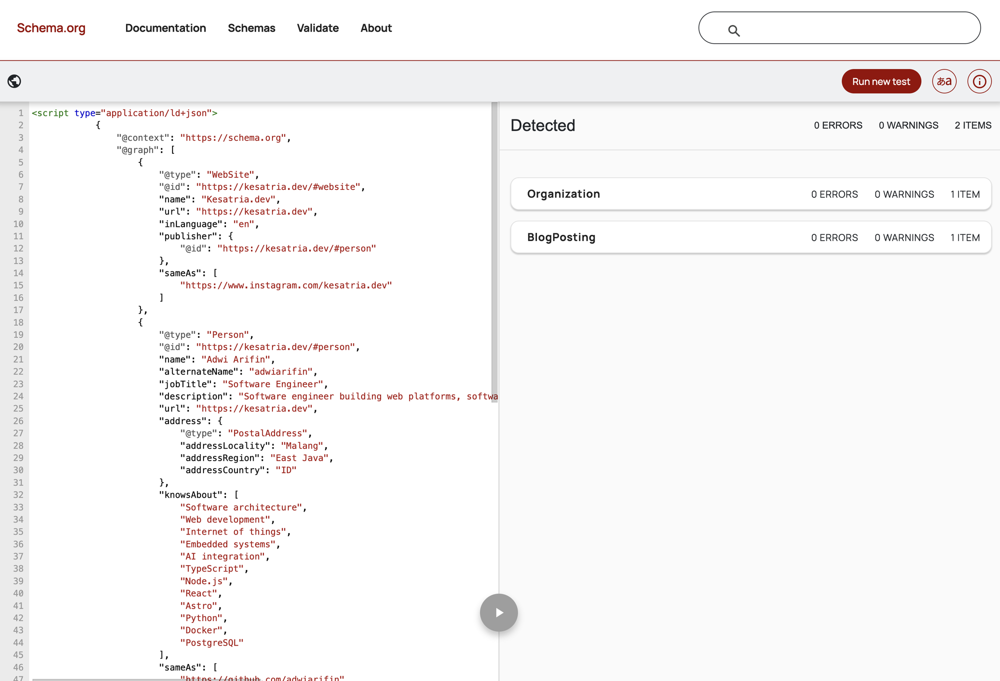
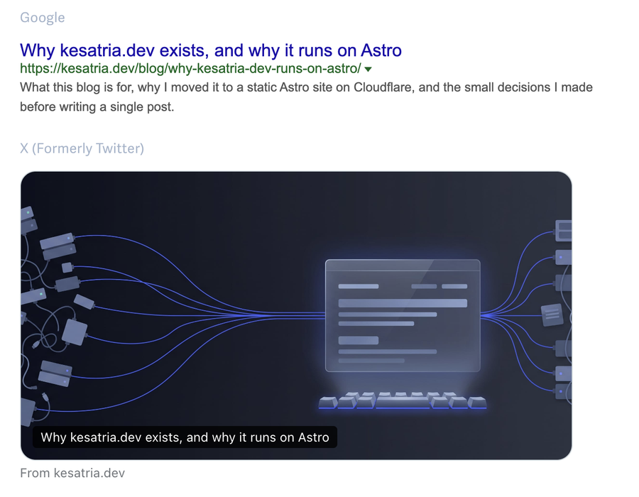

Search engines read your HTML, but they also read structured data: a block of JSON-LD that says, in a vocabulary they understand, "this page is a blog post, written by this person, on this website." For a personal site, that's how you tell search engines that the author of these posts is the same person as the GitHub, LinkedIn, and X accounts with the same name.

Here's how kesatria.dev does it, plus one decision that has more to do with privacy than with SEO.

## Three entities, one graph

The site describes three things:

- **Person:** me, the author.
- **WebSite:** kesatria.dev itself.
- **BlogPosting:** each individual post.

There's also an **Organization** for Kesatria Keyboard, the name I've used online since school and the name of an old blog of mine, kesatriakeyboard.com.

The simple approach is to repeat the full author details inside every post. That works, but it means the same person gets declared many times, with nothing saying it's the same person. Instead, the site-wide entities live once, in the base layout, and each one gets an `@id`:

```js
{
	'@context': 'https://schema.org',
	'@graph': [
		{
			'@type': 'WebSite',
			'@id': `${SITE_URL}/#website`,
			publisher: { '@id': `${SITE_URL}/#person` },
			// ...
		},
		{
			'@type': 'Person',
			'@id': `${SITE_URL}/#person`,
			name: AUTHOR_NAME,
			sameAs: AUTHOR_PROFILES,
			// ...
		},
		{
			'@type': 'Organization',
			'@id': `${SITE_URL}/#kesatria-keyboard`,
			founder: { '@id': `${SITE_URL}/#person` },
			// ...
		},
	],
}
```

An `@id` is just a URL used as a name. It doesn't need to resolve to a page. What matters is that the same string means the same entity everywhere it appears.

Each post then points at those nodes instead of redeclaring them:

```js
{
	'@type': 'BlogPosting',
	headline: title,
	datePublished: pubDate.toISOString(),
	author: {
		'@type': 'Person',
		'@id': `${SITE_URL}/#person`,
		name: AUTHOR_NAME,
		url: SITE_URL,
	},
	isPartOf: { '@id': `${SITE_URL}/#website` },
}
```

The `author` keeps a name and URL inline as well, so the block still makes sense to a parser that reads it on its own. The `@id` is what ties it back to the full Person node.

## `sameAs`: who is who

`sameAs` is the property that links an entity to its profiles elsewhere. It's the most useful part of the whole setup for a personal site, and the easiest to get wrong.

The rule I follow: **each account goes on the entity it actually identifies.**

- My personal GitHub, LinkedIn, and X go on the **Person**.
- The site's own Instagram account goes on the **WebSite**.
- The Kesatria Keyboard accounts go on the **Organization**.

Putting everything on the Person is tempting, because more links feel like more signal. But it's wrong: it tells search engines that a website's accounts *are* me, when they identify the website. Keeping them separate, with the Organization's `founder` pointing to the Person, describes the actual relationship.

In code, that's three separate lists in `src/consts.ts` rather than one:

```ts
export const AUTHOR_PROFILES = [
	'https://github.com/adwiarifin',
	'https://www.linkedin.com/in/adwiarifin',
	'https://x.com/adwiarifin',
];
export const SITE_PROFILES = ['https://www.instagram.com/kesatria.dev'];
export const BRAND_PROFILES = [
	'https://www.instagram.com/kesatriakeyboard',
	'https://www.facebook.com/kesatriakeyboard',
];
```

## The accounts that aren't there

My personal Instagram and Facebook aren't in any of these lists, and that's deliberate.

I actually added my personal Instagram to the Person at first. It's my account, with my name, so it seemed to belong there. Then I took it out. Those accounts are private and for friends and family. Adding them to `sameAs` tells search engines, in the most explicit way available, that my private life and my public engineering work are the same entity. That's the opposite of what I want.

Google doesn't need to know which of my accounts has the cat photos.

So structured data turned out to be a privacy decision as much as an SEO one. The question isn't only "what can I link?" but "what do I want linked?" There's now a comment in the code so I don't undo it later:

```ts
// Instagram/Facebook @adwiarifin are deliberately absent: that tier is
// private, and `sameAs` would tie it to the public engineering identity.
```

## Two small details that matter

**Escape `<` in the JSON.** JSON-LD sits inside a `<script>` tag. If a post title ever contains `</script>`, the browser ends the tag right there and the rest spills into the page. Replacing `<` with its Unicode escape keeps the JSON valid and the tag intact:

```js
const json = JSON.stringify(structuredData).replace(/</g, '\\u003c');
```

**Keep the default social image at a stable URL.** The fallback Open Graph image lives in `public/`, not `src/assets/`. Astro adds a content hash to processed assets, so the URL changes whenever the image does. Social platforms cache link previews by image URL, so a stable path is easier to reason about.

## Checking it

The easiest check is the [Schema Markup Validator](https://validator.schema.org). It can't always fetch a URL, so I paste the page source into the code snippet tab instead. Both `<script>` tags go in together, the site-wide graph and the post's `BlogPosting`.

I ran the published first post through it. The result was no errors, no warnings, and two detected items: the `Organization` and the `BlogPosting`.



JSON-LD isn't the only metadata worth checking. The Open Graph tags decide what a shared link looks like, and a tool like [metatags.io](https://metatags.io) shows that before anyone else sees it. This is the published first post, as Google and X would show it:



Structured data doesn't guarantee anything. Search engines treat it as a hint, not an instruction. But a clean, connected graph is the clearest hint you can give, and for a personal site that's mostly about one question: is this the same person?

Next week: something with a buzzer.
